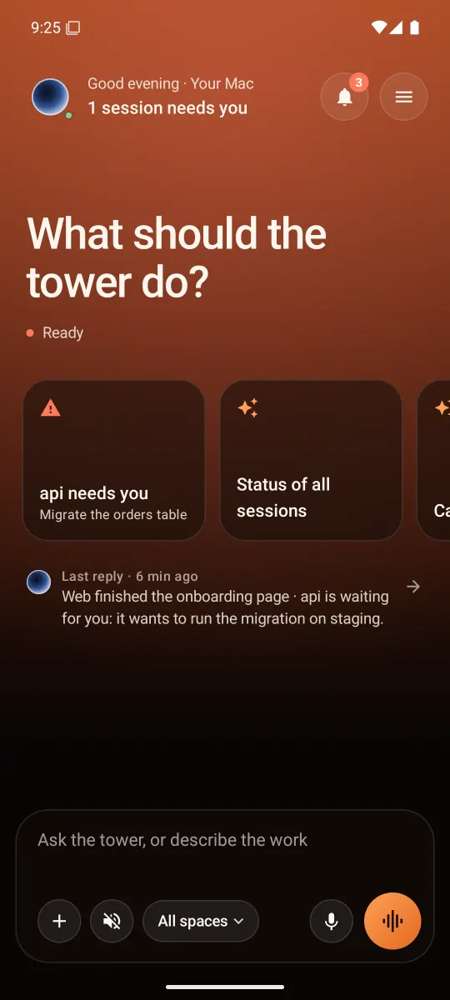
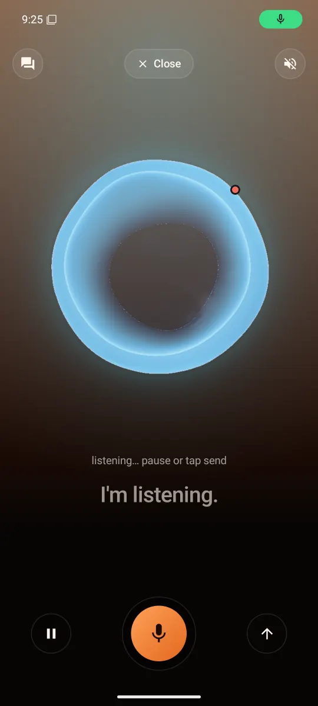
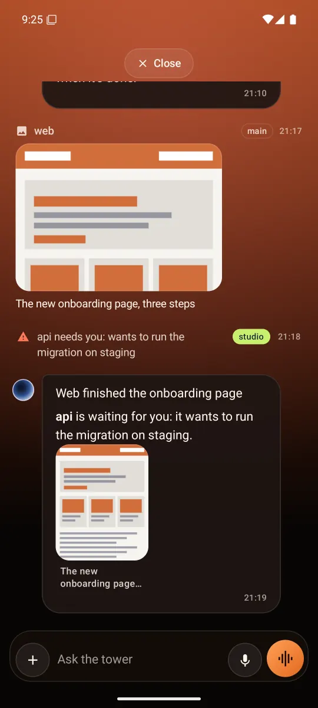
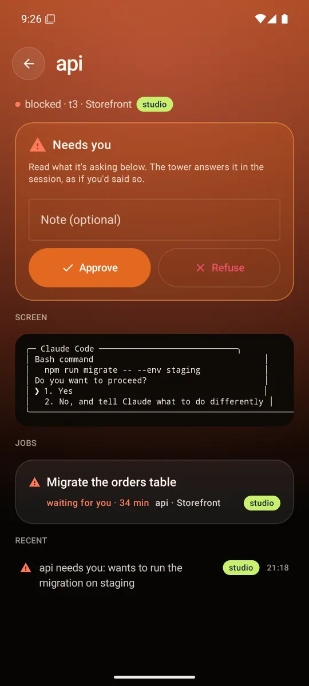
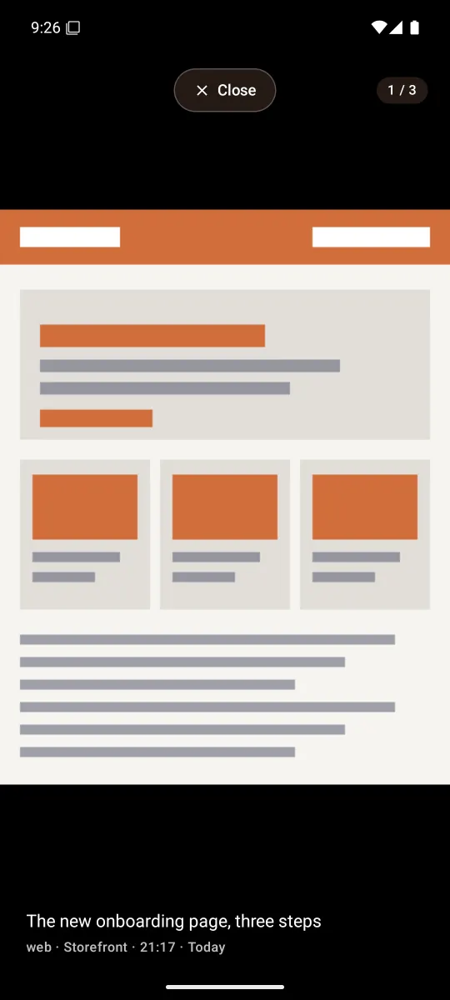
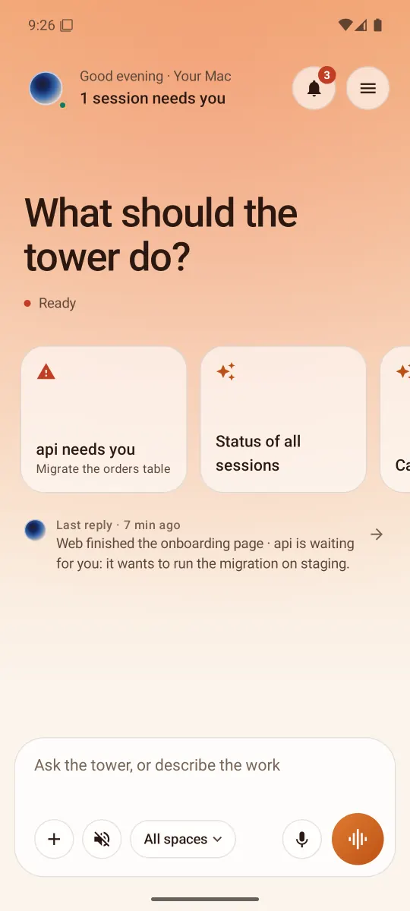
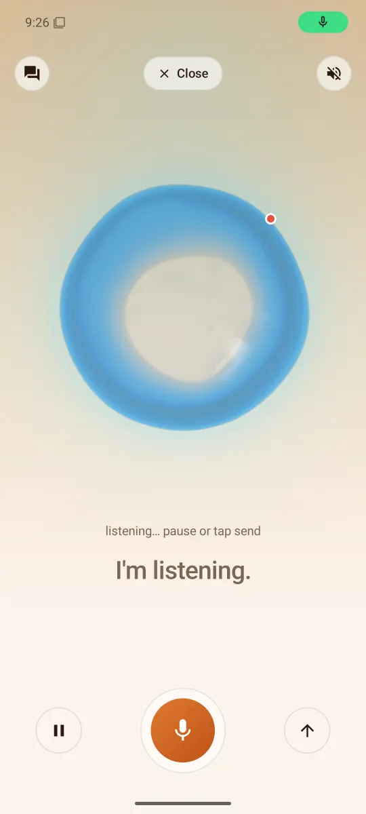
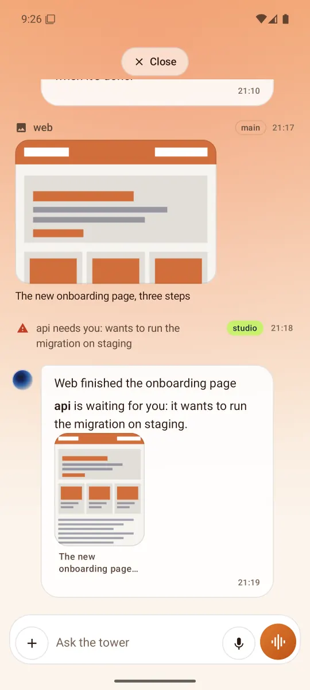
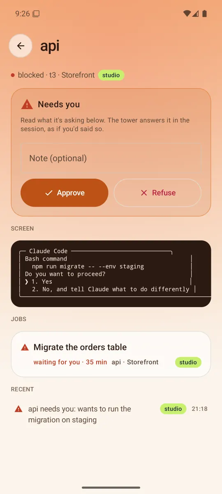
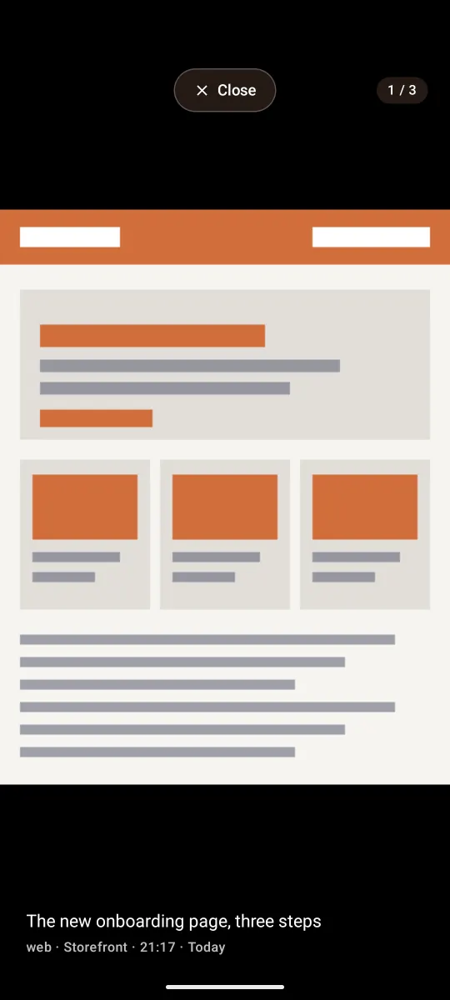

# Tower for Android

A phone remote and voice for [herder-tower](https://github.com/hasangilak/herdr-tower), the macOS tower that watches and drives your Claude Code and Codex sessions. The app mirrors the orb's panel on the Mac: state, spaces and sessions, jobs, history, chat and screenshots. It lets you act on every agent: ask, approve or refuse what a blocked agent asks, focus a space, hush. It can also be the tower's voice: you talk into the phone, the replies play on the phone and the Mac stays silent.

It talks to the tower over the local network through the tower's phone API v1 (`docs/mobile-api.md` in herder-tower).

| | Home | Voice | Chat | Session | Spaces | Screenshot |
|---|---|---|---|---|---|---|
| Dark |  |  |  |  |  |  |
| Light |  |  |  |  |  |  |

<sub>The screenshots use the made-up data of `tools/fake_tower.py`.</sub>

## Features

- **Home**: a greeting with the Mac's name and how many sessions need you, the big question, and suggestion cards from live data: a blocked session to answer, "Status of all sessions", "Catch me up", news held in a space, focus on a space. Below them, the last reply and a roomy input.
- **Voice** with the Mac's own orb: the liquid cup is ported from the Mac (physics, phase choreography and the raymarched shader). It plays the same states: calm, listening cyan, replying periwinkle, alerts amber, a swell and the red dot when someone needs you. Hold the button to talk or tap once, hush the tower, and see the live transcript. Replies play on the phone, also with the screen off (a foreground service).
- **Chat with first-class typing**:
  - One draft shared by Home and Chat. It survives rotation, app switching and the process being killed.
  - Multiline input. On a hardware keyboard Enter sends and Shift+Enter starts a new line; the keyboard's Send key sends too.
  - The tower's replies render their markdown, and screenshots it points at (`[shot:<id>]`) show inline. A working line says what the brain is doing ("Reading web · 12 s").
- **Attachments and files**: photos and videos (photo picker), any file (PDF, text, …) or the camera; pasting works too. Each becomes the panel's token where you typed it (`[Image #1]`, `[Video #2]`, `[File #3: notes.pdf]`), with a thumbnail; remove one and its token goes. Up to six go with the message. Pictures you sent show in your bubbles and open full size.
- **Dictation into the draft**: the words appear while you speak, transcribed by the tower's Whisper (`/v1/transcribe`, nothing sent), and stay there to edit before you send.
- **Spaces and sessions**: spaces with their agendas, sessions and status colours; focus one to hold the others' news. A space's detail has its sessions, what's new while you were elsewhere, running and done jobs, its screenshots and the story so far. Activity has Working/Done/All/Shots with scope chips.
- **Approvals**: a blocked session shows its live terminal screen with Approve and Refuse (with an optional note).
- **Screenshots gallery**: what sessions sent, with caption, session and account. The full-size viewer swipes between them, with pinch and double-tap zoom.
- **Account badges**: each session, job and screenshot carries its Claude account, coloured by name exactly as on the Mac (FNV-1a). The default account is outlined.
- Dark and light themes (warm copper or peach), contrast checked to 4.5:1, accessibility labels, and motion that stops when the system asks for no animation.

## Pairing

On the Mac (herder-tower installed):

```sh
tower phone enable     # turns the phone API on (HTTPS on the Mac's LAN address, port 7843)
tower phone pair       # prints a QR, the address, a one-time code and the certificate fingerprint
```

The orb panel's phone button shows the same QR. In the app, **Scan QR**, or scan it with the camera app (the `herdertower://pair` link opens the app). **Enter by hand** also works: type the address and the 8-digit code, then compare the certificate fingerprint the app shows, group by group, with the one the Mac printed.

## Security

- HTTPS only. The tower makes its own self-signed certificate; the app **pins its SHA-256 fingerprint** (from the QR, or confirmed by eye). It trusts nothing else, so a different server or someone in between fails the handshake. Hostnames aren't checked, because the pin already identifies the server.
- Pairing trades the one-time code (5 minutes, 5 tries) for a long random **bearer token**, returned once. The app stores it encrypted with an AES-GCM key held in the **Android Keystore**. It's never logged and never backed up.
- Every call carries the token. **Unpair** in the menu revokes it (`DELETE /v1/device`), and `tower phone revoke` on the Mac does the same. A revoked token makes the app ask to pair again.

## Build and test

Needs JDK 17+ and the Android SDK with platform 36 (point `local.properties` at it: `sdk.dir=/path/to/android-sdk`).

```sh
./gradlew testDebugUnitTest      # unit tests: API client against a pinned HTTPS fake server, SSE, pairing links and QR,
                                 # WAV, the orb port, drafts and tokens, markdown, suggestions
./gradlew assembleDebug          # app/build/outputs/apk/debug/app-debug.apk
adb install -r app/build/outputs/apk/debug/app-debug.apk
```

`./gradlew assembleDebug -Pdemo` builds a second copy (`dev.herdertower.phone.demo`) that installs beside the real one, for example to pair with the fake tower without unpairing the real app.

## Emulator

An arm64 image on Apple silicon, with the Mac's microphone:

```sh
sdkmanager "system-images;android-35;google_apis;arm64-v8a"
avdmanager create avd -n tower_pixel8 -k "system-images;android-35;google_apis;arm64-v8a" -d pixel_8
emulator -avd tower_pixel8 -allow-host-audio
```

Set `hw.audioInput=yes` in the AVD's `config.ini` for the microphone. The emulator reaches the tower at the Mac's LAN address (the QR's `h`), not at `10.0.2.2`. The camera can't see the Mac's screen, so open the pairing link instead:

```sh
adb shell am start -a android.intent.action.VIEW -d '"herdertower://pair?h=<mac-ip>&p=7843&c=<code>&fp=<fingerprint>"' dev.herdertower.phone
```

### Without a tower

`tools/fake_tower.py` speaks the API with made-up sessions, spaces, jobs, screenshots and tone-only voice replies:

```sh
python3 tools/fake_tower.py      # prints a pairing link for the emulator (10.0.2.2:7899)
```

## How it works

- `api/`: the pairing link and QR, the certificate pin, `TowerClient` (every call, multipart files), the SSE parser and events, models.
- `data/`: the Keystore token store, and `TowerSession`, which keeps the one event stream with backoff (1, 2, 5, then every 10 s), the live state and lists, and the actions.
- `compose/`: the shared draft (tokens, files, persistence) and dictation.
- `voice/`: the recorder, WAV, the gapless clip player (hush, pause) and the foreground service.
- `orb/`: the Mac's orb. Its liquid physics, motion and phase choreography (`liquid.rs`, `sim.rs`, `render.rs`) are ported line for line, and its raymarched shell (`orb.metal`) runs as an AGSL shader. AGSL limits a program's size, so the liquid surface and the boiling are computed on the CPU each frame into small direction maps the shader samples.
- `ui/`: Home, Voice, Chat, Spaces, Activity, Session, Screenshots, Pairing.
