# Tower for Android

The phone side of [herder-tower](https://github.com/hasangilak/herdr-tower), the macOS tower that watches and drives your Claude Code and Codex sessions. The tower does the work and keeps the record; the app shows what is yours: **your queue** of decisions only you can make, each with large answers. It notifies for a new decision and for nothing else. Spaces are missions with a goal and an end, and one talk button on every screen reaches the tower (or a space's own).

It talks to the tower over the local network or Tailscale through the tower's phone API v1 (`docs/mobile-api.md` and `docs/quiet-tower.md`, "Step 11: the phone", in herder-tower).

| | Queue | A space | Talking | Spaces | Record | Shots |
|---|---|---|---|---|---|---|
| Dark | 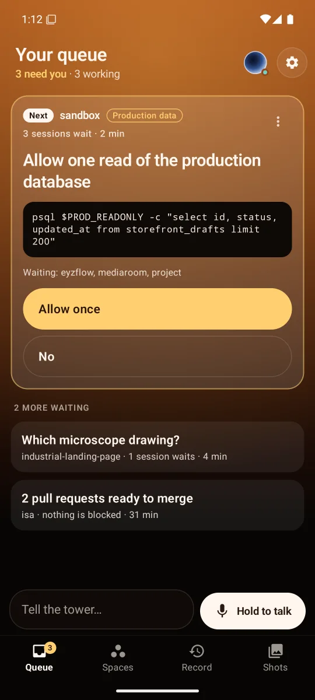 | 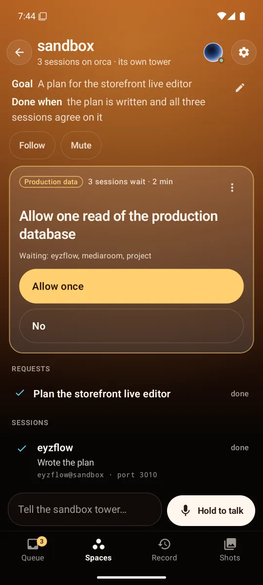 | 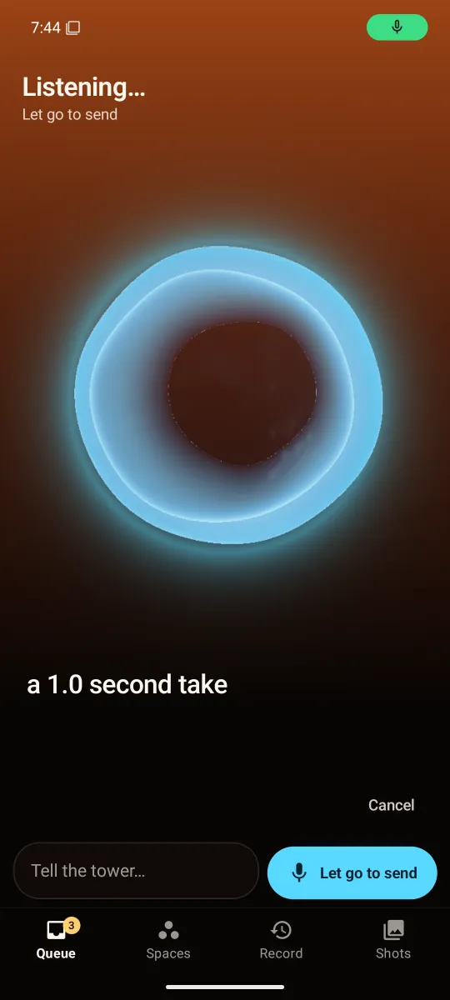 | 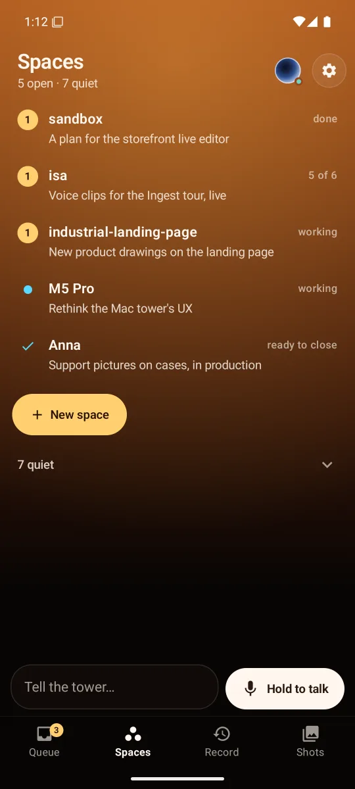 | 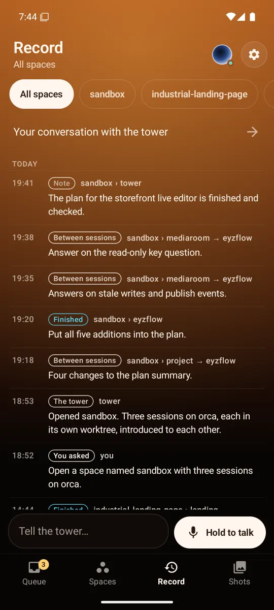 | 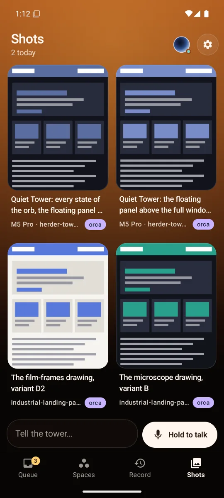 |
| Light | 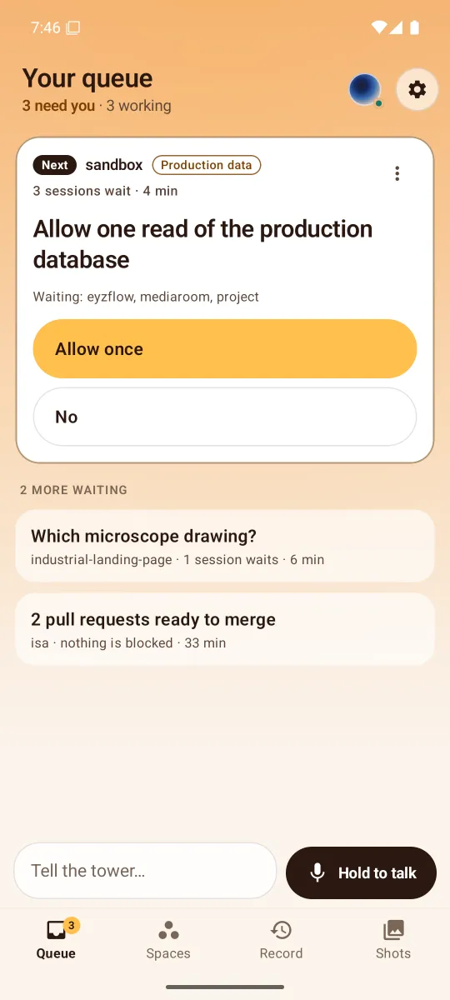 | 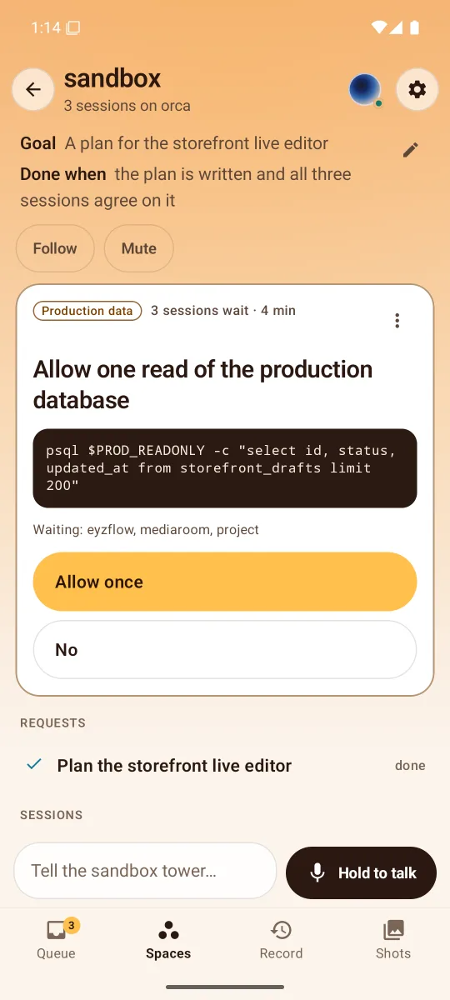 | 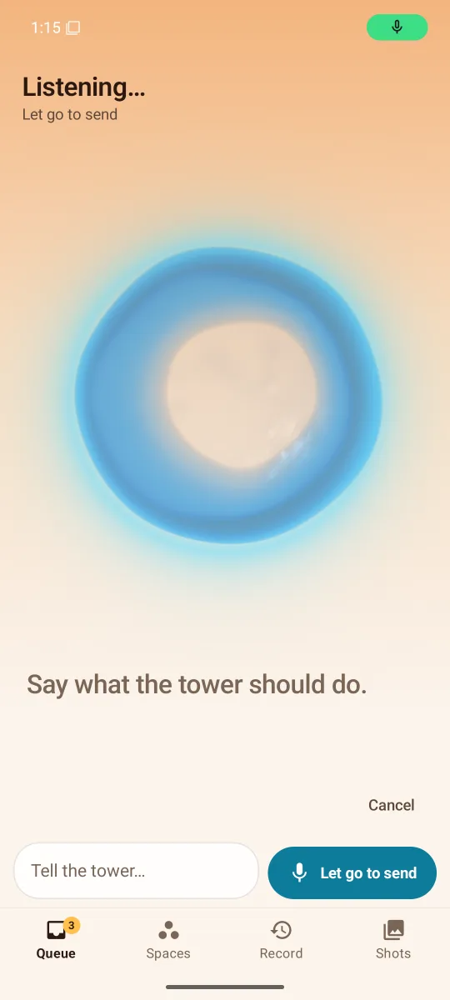 | 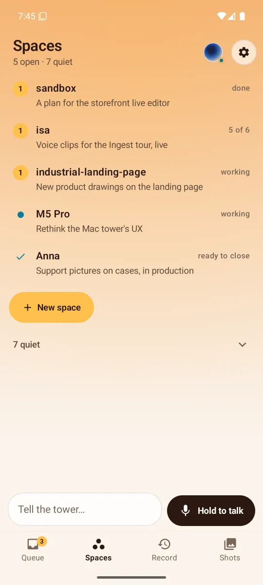 | 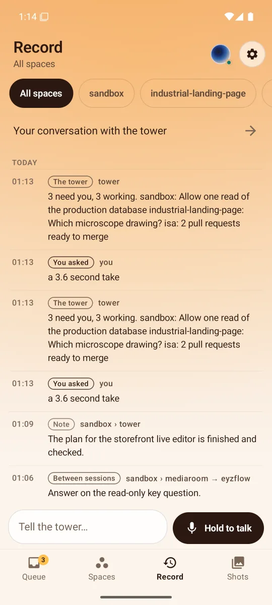 | 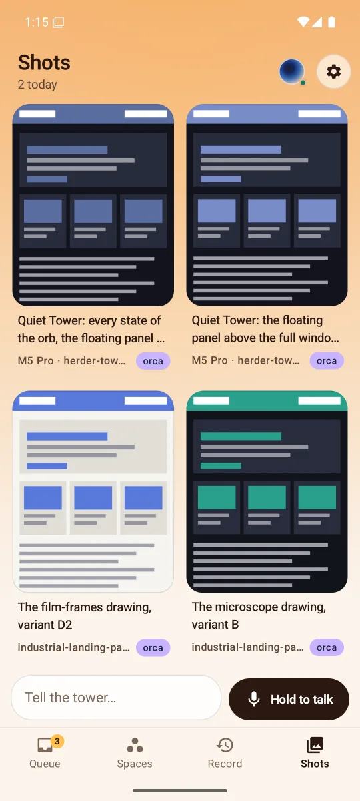 |

<sub>The screenshots use the made-up data of `tools/fake_tower.py`.</sub>

## Features

- **Your queue**: where the app opens. One decision is open: where it comes from, why it's yours ("Production data", "Merge", "Design choice"), how many sessions wait and for how long, what it's about (the command, the pull requests with their checks), and its answers as large buttons, the tower's own pick first. The others wait behind it in the tower's order; tap one to open it. "Other answer" takes your own words; a set of several questions opens a stepper with every option, files and a spoken answer. A merge whose checks fail takes a second, explicit yes.
- **On hold**: any card's menu puts it on hold, with your words ("wait for the ingest filters"). It stays open but leaves the queue, the header, the tab's badge and its space's number, and never notifies; it is listed under **On hold** (in the queue and in its space) with your words, who held it and since when, and **Back to waiting**. When it comes back by itself (new commits, the PR it waited for merged) it notifies once and its card says why.
- **Merge cards** merge only what is ready: drafts, PRs whose review still runs and PRs their session is fixing (conflicts, behind their base) are left out, each saying why; a PR being fixed shows as "Being fixed by eyzflow" on its chip, not as a merge. With several ready, one button names exactly those ("Merge #839 and #842") and steps through each PR's own look-then-merge in order.
- **Blocked cards** whose session's dialog the tower has read since show its options as answer buttons; Show on Mac stays as the way out.
- **Accounts**: each Claude account's usage over the spaces (the fullest window as a bar, amber from 80 %, "out until 15:00" while out; tap for both windows and what the failover moved), and on a space's screen each session's and its tower's account, a moved one marked "moved from default at 15:02".
- **One notification**: a decision the phone hasn't seen, while the app isn't on screen, with its first two answers as actions (the phone asks for its unlock first) and Open. Nothing else notifies: no finishes, no deliveries, no messages between sessions.
- **Spaces as missions** (a goal that grew with your requests says so: "Goal, updated by your request at 15:55", with the earlier versions folded): each with its goal, how far it is ("5 of 6", "working", "ready to close") and an amber number when something there is yours. A space's own screen has its goal and what counts as done, Follow and Mute, its decisions, its requests, its sessions (worktree and port), what its sessions wrote each other, its closing report and Close. **New space** launches one from a sentence and a saved setup; nothing is asked.
- **A session**: its last words, its live terminal screen, and Show on Mac, which brings it to the front in Herdr.
- **One talk bar on every screen**: hold the button and talk, let go to send (or tap once and talk until you pause). While you talk the Mac's words appear, under the tower's orb. Beside it a line to type, with files (photos, videos, any file, the camera) and dictation. On a space's screens both go to that space's own tower. The reply shows as a card above the queue and is spoken where you chose (this phone or the Mac).
- **Record**: everything the tower did and heard, by space, newest first: what finished, what sessions wrote each other, what was answered for you, what you asked. The whole conversation with the tower is one tap away, with its pictures and PR chips.
- **Shots**: what sessions sent, with caption, space and account. The full-size viewer swipes between them, with pinch and double-tap zoom.
- **Settings**: where replies are heard, what notifies (decisions, or decisions and results: the tower's one setting for how much it tells you), the phone as the tower's voice, the look, the pairing; and the tower's own (how session questions are handled, the Mac's microphone, behaviors).
- **An older tower works too**: without the queue's calls (they answer 404) the app makes the same queue from the tower's question sets and its waiting pull requests (merged through the sheet that looks first), and the missions from its spaces and jobs.
- The Mac's own orb (the liquid cup, ported: physics, phase choreography and the raymarched shader), tapped to mute the whole tower; Stop while it talks. Replies play on the phone also with the screen off (a foreground service) when the phone is the voice.
- Dark and light themes (warm copper or peach), contrast checked to 4.5:1, accessibility labels, and motion that stops when the system asks for no animation.

## Pairing

On the Mac (herder-tower installed):

```sh
tower phone enable     # turns the phone API on (HTTPS on the Mac's LAN address, port 7843)
tower phone pair       # prints a QR, the address, a one-time code and the certificate fingerprint
```

The orb panel's phone button shows the same QR. In the app, **Scan QR**, or scan it with the camera app (the `herdertower://pair` link opens the app). **Enter by hand** also works: type the address and the 8-digit code, then compare the certificate fingerprint the app shows, group by group, with the one the Mac printed.

## Security

- HTTPS only. The tower makes its own self-signed certificate; the app **pins its SHA-256 fingerprint** (from the QR, or confirmed by eye). It trusts nothing else, so a different server or someone in between fails the handshake. Hostnames aren't checked, because the pin already identifies the server.
- Pairing trades the one-time code (5 minutes, 5 tries) for a long random **bearer token**, returned once. The app stores it encrypted with an AES-GCM key held in the **Android Keystore**. It's never logged and never backed up.
- Every call carries the token. **Unpair** in Settings revokes it (`DELETE /v1/device`), and `tower phone revoke` on the Mac does the same. A revoked token makes the app ask to pair again.

## Build and test

Needs JDK 17+ and the Android SDK with platform 36 (point `local.properties` at it: `sdk.dir=/path/to/android-sdk`).

```sh
./gradlew testDebugUnitTest      # unit tests: API client and session against a pinned HTTPS fake server, SSE, the queue and
                                 # its fallback, notifications, routes, pairing links and QR, WAV, the orb port, drafts, markdown
./gradlew assembleDebug          # app/build/outputs/apk/debug/app-debug.apk
adb install -r app/build/outputs/apk/debug/app-debug.apk
```

`./gradlew assembleDebug -Pdemo` builds a second copy (`dev.herdertower.phone.demo`) that installs beside the real one, for example to pair with the fake tower without unpairing the real app.

## Emulator

An arm64 image on Apple silicon, with the Mac's microphone:

```sh
sdkmanager "system-images;android-35;google_apis;arm64-v8a"
avdmanager create avd -n tower_pixel8 -k "system-images;android-35;google_apis;arm64-v8a" -d pixel_8
emulator -avd tower_pixel8 -allow-host-audio
```

Set `hw.audioInput=yes` in the AVD's `config.ini` for the microphone. The emulator reaches the tower at the Mac's LAN address (the QR's `h`), not at `10.0.2.2`. The camera can't see the Mac's screen, so open the pairing link instead:

```sh
adb shell am start -a android.intent.action.VIEW -d '"herdertower://pair?h=<mac-ip>&p=7843&c=<code>&fp=<fingerprint>"' dev.herdertower.phone
```

### Without a tower

`tools/fake_tower.py` speaks the API with made-up data and tone-only voice replies:

```sh
python3 tools/fake_tower.py      # prints a pairing link for the emulator (10.0.2.2:7899)
```

By default it is a quiet tower with the design's own example: three decisions (a production read, a design choice, two pull requests to merge), five missions, a thread between sessions, saved setups, a record and shots. It answers decisions, launches and closes spaces, and replies to "what's left?" or "open a session…" as the quiet tower does. `FAKE_QUESTIONS=0` keeps session question sets from coming up, so the queue stays those three. To raise a decision (and see its notification with the app in the background):

```sh
curl -sk -X POST https://127.0.0.1:7899/v1/fake/decision -d '{"title":"Deploy the editor to production?","space":"sandbox","why":"Deploy","sessions":["s1"],"options":[{"label":"Deploy","pick":true},{"label":"Not yet"}]}'
```

`--legacy` makes it a tower from before the queue: decisions, missions, thread, setups, launch and tell answer 404, and the data is a small shop with question sets and PR chips in every state (pending, passing, failing into main, conflicting, merged, closed), merged only in memory. There, `FAKE_PR_MERGE_FAIL=1` makes "GitHub" refuse the first merge, so the retry card shows; `FAKE_PR_CHECKS_S=40` sets when #88's checks pass and it starts waiting; `POST /v1/fake/pr` with `{"key": "example/api#88", …fields}` changes a PR live.

`--hosts lan:192.0.2.1:7899,tailscale:10.0.2.2:7899 --dns mac.tailnet.ts.net` pairs the way a tower with Tailscale does. The link carries every address, and the state carries `lan_hosts`. Here the LAN address isn't there, so the app falls back to the second address and shows "over Tailscale".

## How it works

- `api/`: the pairing link and QR, the certificate pin, `TowerClient` (every call, multipart files), the SSE parser and events, models; `Decisions.kt` and `Missions.kt` are the queue and the missions, with the same made from an older tower's questions, PRs, spaces and jobs.
- `data/`: the Keystore token store, and `TowerSession`, which keeps the one event stream with backoff (1, 2, 5, then every 10 s), the live state and lists, the queue with this phone's answers on their way, and the actions. `DecisionNotices` posts the one notification and takes an answer tapped on it; `DecisionCheck` reads the queue every 15 minutes while no stream is open.
- `compose/`: the shared draft (tokens, files, persistence) and dictation.
- `voice/`: the recorder, WAV, the talk button's takes (to the main tower, to a space, or into a field) with the Mac's words while talking, the gapless clip player (hush, pause) and the foreground service.
- `orb/`: the Mac's orb. Its liquid physics, motion and phase choreography (`liquid.rs`, `sim.rs`, `render.rs`) are ported line for line, and its raymarched shell (`orb.metal`) runs as an AGSL shader. AGSL limits a program's size, so the liquid surface and the boiling are computed on the CPU each frame into small direction maps the shader samples.
- `ui/`: the shell with its four tabs and the talk bar, Queue, Spaces, a space, a session, New space, Record, Shots, Settings, the conversation, the question stepper, Pairing. What each says in words sits in small objects beside its screen (`DecisionModel`, `ReplyModel`, `RecordModel`, …), which the tests read.

Notifications come from the event stream while it is open: while the app is on screen, for two minutes after you say or answer something, and always while the phone is the tower's voice. With the app closed and the phone not the voice there is no push channel, so `DecisionCheck` (WorkManager, every 15 minutes while paired, with a network) reads the queue once: a new decision notifies within 15 minutes. Android may run it later in Doze or battery saver.
