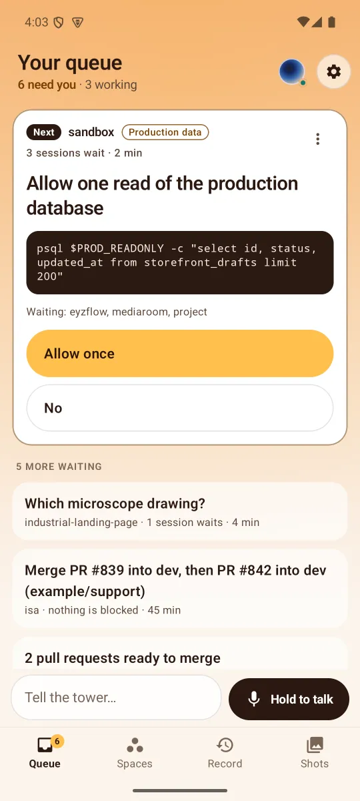
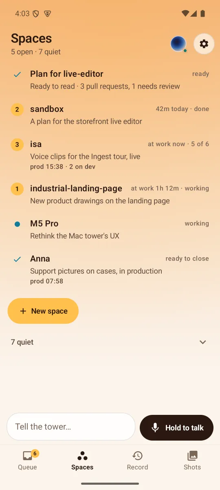
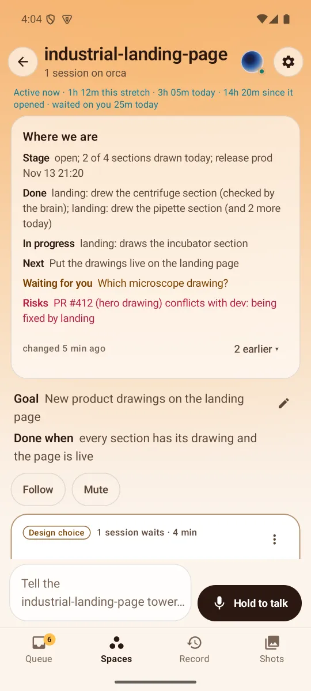
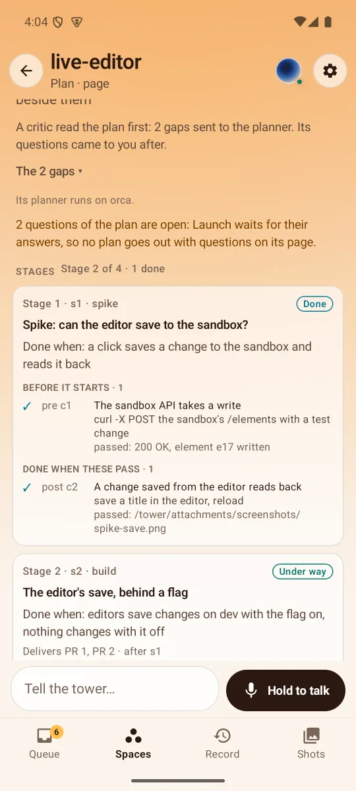
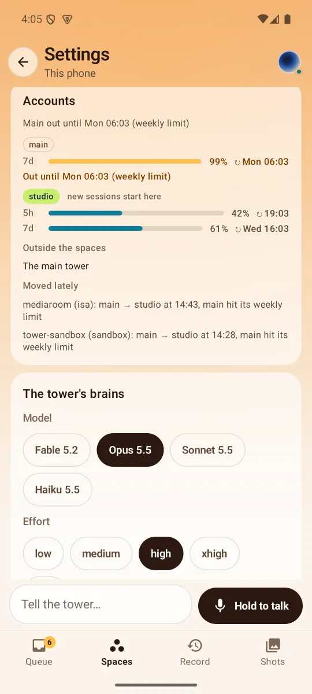

# Tower for Android

The phone side of [herder-tower](https://github.com/hasangilak/herdr-tower), the macOS tower that watches and drives your Claude Code and Codex sessions. The tower does the work and keeps the record. The app shows what is yours: **your queue** of decisions only you can make, each with real answer buttons, and where every space and session stands. It notifies for a new decision and for nothing else, and one talk button on every screen reaches the tower (or a space's own).

It talks to the tower over the local network or Tailscale through the tower's phone API v1 (`docs/mobile-api.md` in herder-tower). Version 0.71.

| Queue | Spaces | A space | A plan | Settings |
|---|---|---|---|---|
|  |  |  |  |  |

<sub>The screenshots use the made-up data of `tools/fake_tower.py`.</sub>

## What it does with the tower

**Your queue.** Where the app opens. One decision is open: where it comes from, why it's yours ("Production data", "Merge", "Design choice"), how many sessions wait and for how long, what it's about (the command, the pull requests with their checks), and its answers as large buttons, the tower's own pick first. The others wait behind it in the tower's order. "Other answer" takes your own words; a set of several questions opens a stepper with every option, files and a spoken answer. A session blocked on a dialog the tower has read gets that dialog's options as buttons; Show on Mac stays as the way out.

**On hold.** Any card's menu puts it on hold, with your words ("wait for the ingest filters"). It stays open but leaves the queue, the header, the tab's badge and its space's number, and never notifies. It is listed under **On hold** with your words, who held it and since when, and **Back to waiting**. When it comes back by itself (new commits, the PR it waited for merged) it notifies once and says why.

**Merge cards.** A merge card merges only what is ready: drafts, PRs whose review still runs and PRs their session is fixing are left out, each saying why. A PR's summary and its whole description are on its row. With several ready, one button names exactly those ("Merge #839 and #842"). With a tower that runs merge chains, that button hands the chain to the tower, which merges them in order and has a PR that fell behind fixed first; the card shows where each PR stands and **Stop merging**. Otherwise each PR's own look-then-merge runs in order from the phone. A merge whose checks fail takes a second, explicit yes.

**Spaces.** Each space is a mission with a goal and an end: how far it is, an amber number when something there is yours, and how long its sessions have been at work ("at work 12m", "1h 12m today"). A space's screen has:

- its **active time**: "Active now · 1h 12m this stretch · 3h 05m today · 14h 20m since it opened · waited on you 25m today";
- its **brief**, "Where we are": Stage, Done, In progress, Next, Waiting for you, Risks, with when it changed and its earlier versions;
- its goal (with how it grew from your requests), Follow and Mute, its decisions, the plan it was launched with, its release track, its requests, its sessions and what they wrote each other, its closing report and Close.

Each session row says what it does now: while it works, a progress line kept true against the clock ("step 3 of 7: running the test suite · 14 min in · last update 1 min ago"), its brief folded under it, its account, and its jobs. **New space** launches one from a sentence and a saved setup.

**A session.** How its turn goes, with its task list, and **How is it going?**: the session is asked aside, without stopping it, and its answer shows there. Its last words, its live terminal screen, the jobs and servers it left running, and Show on Mac.

**Plans.** A plan the tower's planner writes shows its stages (each with what counts as done, the checks before it starts and the checks that make it done, each ✓ ✗ – ○ with its evidence, and the agenda tasks sent for it), its questions (answered by you or by the tower, in your queue, or with the tower), its assumptions, the critic's read before its questions went out, and why Launch waits while questions are open. Once launched, the space shows the plan's version, how far each stage is, the findings that wait, and what changed: each revision, small ones applied by themselves, a big one waiting for your word with its whole diff on its card.

**Accounts.** In Settings: each Claude account's usage (its windows as bars with when they reset, amber from 80 %, "out until Mon 06:03" while out), where new sessions start, the main tower and the sessions outside every space with their accounts, and what the account failover moved lately. A space's screen shows each session's and its tower's account, a moved one marked "moved from main at 14:28".

**Voice and chat.** One talk bar on every screen: hold the button and talk, let go to send, or tap once and talk until you pause. While you talk the Mac's words appear under the tower's orb. Beside it a line to type, with files (photos, videos, any file, the camera) and dictation. On a space's screens both go to that space's own tower. The reply shows as a card above the queue and is spoken where you chose (this phone or the Mac); the whole conversation is one tap away, each answer saying what it answers. **Record** has everything the tower did and heard, by space; **Shots** has what sessions sent, full size.

**One notification.** A decision the phone hasn't seen, while the app isn't on screen, with its first two answers as actions (the phone asks for its unlock first) and Open. Nothing else notifies.

Also: the Mac's own orb (its liquid physics and raymarched shader, ported), tapped to mute the whole tower; dark and light themes, contrast checked to 4.5:1, accessibility labels, and motion that stops when the system asks for none. An older tower works too: without a call the app falls back to what the tower does have.

## Pairing with the tower

On the Mac, with [herder-tower](https://github.com/hasangilak/herdr-tower) installed:

```sh
tower phone enable     # turns the phone API on (HTTPS on the Mac's LAN address, port 7843)
tower phone pair       # prints a QR, the address, a one-time code and the certificate fingerprint
```

The orb panel's phone button shows the same QR. In the app, **Scan QR**, or scan it with the camera app (the `herdertower://pair` link opens the app). **Enter by hand** also works: type the address and the 8-digit code, then compare the certificate fingerprint the app shows, group by group, with the one the Mac printed. With Tailscale running on the Mac, the pairing carries its address too, and the app reaches the tower away from the office or home network.

## Security

- HTTPS only. The tower makes its own self-signed certificate; the app **pins its SHA-256 fingerprint** (from the QR, or confirmed by eye). It trusts nothing else, so a different server or someone in between fails the handshake. Hostnames aren't checked, because the pin already identifies the server.
- Pairing trades the one-time code (5 minutes, 5 tries) for a long random **bearer token**, returned once. The app stores it encrypted with an AES-GCM key held in the **Android Keystore**. It's never logged and never backed up.
- Every call carries the token. **Unpair** in Settings revokes it (`DELETE /v1/device`), and `tower phone revoke` on the Mac does the same. A revoked token makes the app ask to pair again.

## Build

Needs JDK 17+ and the Android SDK with platform 36 (point `local.properties` at it: `sdk.dir=/path/to/android-sdk`).

```sh
./gradlew testDebugUnitTest      # the unit tests: API client and session against a pinned HTTPS fake server, the queue,
                                 # notifications, pairing, the words each screen says, the orb port
./gradlew assembleDebug          # a debug build: app/build/outputs/apk/debug/app-debug.apk
```

`./gradlew assembleDebug -Pdemo` builds a second copy (`dev.herdertower.phone.demo`) that installs beside the real one, for example to pair with the fake tower without unpairing the real app.

### The signed release

The release build is R8-shrunk and signed with your own key, named in `~/.gradle/gradle.properties` (kept out of the repo):

```properties
towerReleaseKeystore=/path/to/your-release.jks
towerReleaseKeystorePassword=…
towerReleaseKeyAlias=…
```

```sh
keytool -genkeypair -v -keystore your-release.jks -alias tower -keyalg RSA -keysize 4096 -validity 10000   # once
./gradlew assembleRelease        # app/build/outputs/apk/release/app-release.apk, about 6 MB
apksigner verify --print-certs app/build/outputs/apk/release/app-release.apk
adb install -r app/build/outputs/apk/release/app-release.apk
```

Without a release key the release falls back to the debug key, with a warning. Keep using the same key: Android only installs an update signed like the copy it has; a different key means uninstalling the old copy and pairing again. The version is the number of commits (`0.<commits>`).

## Emulator

An arm64 image on Apple silicon, with the Mac's microphone:

```sh
sdkmanager "system-images;android-35;google_apis;arm64-v8a"
avdmanager create avd -n tower_pixel8 -k "system-images;android-35;google_apis;arm64-v8a" -d pixel_8
emulator -avd tower_pixel8 -allow-host-audio
```

Set `hw.audioInput=yes` in the AVD's `config.ini` for the microphone. The emulator reaches the tower at the Mac's LAN address (the QR's `h`), not at `10.0.2.2`. The camera can't see the Mac's screen, so open the pairing link instead:

```sh
adb shell am start -a android.intent.action.VIEW -d '"herdertower://pair?h=<mac-ip>&p=7843&c=<code>&fp=<fingerprint>"' dev.herdertower.phone
```

### Without a tower

`tools/fake_tower.py` speaks the API with made-up data and tone-only voice replies:

```sh
python3 tools/fake_tower.py      # prints a pairing link for the emulator (10.0.2.2:7899)
```

By default it is a quiet tower with made-up data: decisions (a production read, a design choice, merges, a plan question and a plan revision), five missions with active time and briefs, a plan with stages and questions, a live plan with revisions, accounts and their usage, a thread between sessions, saved setups, a record and shots. It answers decisions, launches and closes spaces, and replies to "what's left?" or "open a session…" as the quiet tower does. `FAKE_QUESTIONS=0` keeps session question sets from coming up, so the queue stays those three. To raise a decision (and see its notification with the app in the background):

```sh
curl -sk -X POST https://127.0.0.1:7899/v1/fake/decision -d '{"title":"Deploy the editor to production?","space":"sandbox","why":"Deploy","sessions":["s1"],"options":[{"label":"Deploy","pick":true},{"label":"Not yet"}]}'
```

`--legacy` makes it a tower from before the queue: decisions, missions, thread, setups, launch and tell answer 404, and the data is a small shop with question sets and PR chips in every state (pending, passing, failing into main, conflicting, merged, closed), merged only in memory. There, `FAKE_PR_MERGE_FAIL=1` makes "GitHub" refuse the first merge, so the retry card shows; `FAKE_PR_CHECKS_S=40` sets when #88's checks pass and it starts waiting; `POST /v1/fake/pr` with `{"key": "example/api#88", …fields}` changes a PR live.

`--hosts lan:192.0.2.1:7899,tailscale:10.0.2.2:7899 --dns mac.tailnet.ts.net` pairs the way a tower with Tailscale does. The link carries every address, and the state carries `lan_hosts`. Here the LAN address isn't there, so the app falls back to the second address and shows "over Tailscale".

## How it works

- `api/`: the pairing link and QR, the certificate pin, `TowerClient` (every call, multipart files), the SSE parser and events, models; `Decisions.kt` and `Missions.kt` are the queue and the missions, with the same made from an older tower's questions, PRs, spaces and jobs.
- `data/`: the Keystore token store, and `TowerSession`, which keeps the one event stream with backoff (1, 2, 5, then every 10 s), the live state and lists, the queue with this phone's answers on their way, and the actions. `DecisionNotices` posts the one notification and takes an answer tapped on it; `DecisionCheck` reads the queue every 15 minutes while no stream is open.
- `compose/`: the shared draft (tokens, files, persistence) and dictation.
- `voice/`: the recorder, WAV, the talk button's takes (to the main tower, to a space, or into a field) with the Mac's words while talking, the gapless clip player (hush, pause) and the foreground service.
- `orb/`: the Mac's orb. Its liquid physics, motion and phase choreography (`liquid.rs`, `sim.rs`, `render.rs`) are ported line for line, and its raymarched shell (`orb.metal`) runs as an AGSL shader. AGSL limits a program's size, so the liquid surface and the boiling are computed on the CPU each frame into small direction maps the shader samples.
- `ui/`: the shell with its four tabs and the talk bar, Queue, Spaces, a space, a session, New space, Record, Shots, Settings, the conversation, the question stepper, Pairing. What each says in words sits in small objects beside its screen (`DecisionModel`, `ReplyModel`, `RecordModel`, …), which the tests read.

Notifications come from the event stream while it is open: while the app is on screen, for two minutes after you say or answer something, and always while the phone is the tower's voice. With the app closed and the phone not the voice there is no push channel, so `DecisionCheck` (WorkManager, every 15 minutes while paired, with a network) reads the queue once: a new decision notifies within 15 minutes. Android may run it later in Doze or battery saver.
